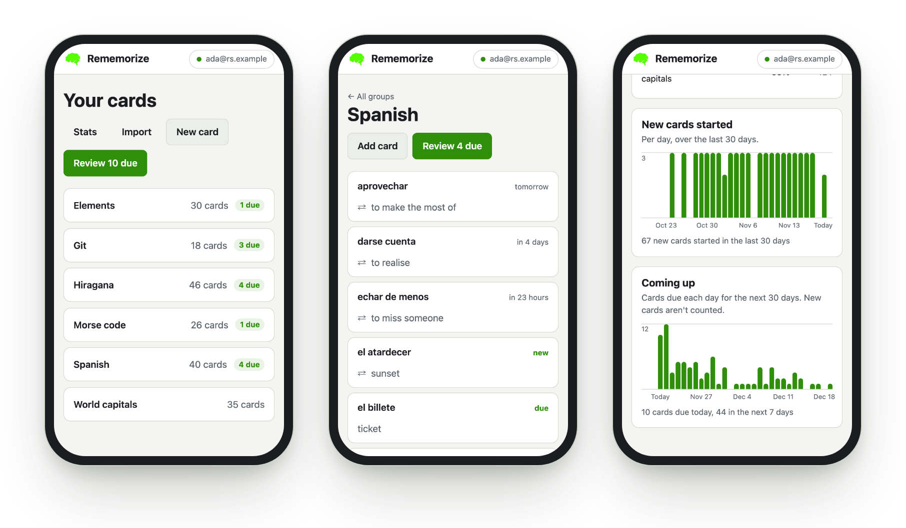

<div align="center">

<picture>
  <source media="(prefers-color-scheme: dark)" srcset="docs/assets/rememorize-dark.svg">
  <source media="(prefers-color-scheme: light)" srcset="docs/assets/rememorize-light.svg">
  
</picture>

### Flashcards that come back just before you forget them.

Works offline. No account needed.<br>
Sync through your own remoteStorage.

[](https://github.com/silverbucket/rememorize/actions/workflows/ci.yml)
[](https://github.com/silverbucket/rememorize/releases)
[](LICENSE)
[](https://remotestorage.io)

**[Open Rememorize →](https://rememorize.5apps.com)**

<br>

<picture>
  <source media="(prefers-color-scheme: dark)" srcset="docs/assets/hero-dark.png">
  <source media="(prefers-color-scheme: light)" srcset="docs/assets/hero-light.png">
  
</picture>

</div>

<br>

Rememorize is a flashcard app. You write the cards, and it shows each one
again just before you would forget it.

It works offline, in your browser or installed on your phone. Link your own
[remoteStorage](https://remotestorage.io) and your cards sync across all your
devices.

## What it does

<table>
<tr>
<td width="50%" valign="top">

**Smart scheduling**

Rate each answer: Again, Hard, Good or Easy. Cards you know come back less and
less often. Cards you miss come back soon. It uses
[FSRS](https://github.com/open-spaced-repetition/ts-fsrs), the same algorithm
as Anki.

</td>
<td width="50%" valign="top">

**Works offline**

Install it on your phone or desktop. Study and edit your cards without a
connection.

</td>
</tr>
<tr>
<td width="50%" valign="top">

**Your own storage**

Link a remoteStorage account and your cards sync across all your devices.
Without one, they stay in your browser.

</td>
<td width="50%" valign="top">

**Both directions**

Study a card front to back, back to front, or both.

</td>
</tr>
<tr>
<td width="50%" valign="top">

**Progress you can see**

A review calendar, your streak, how much you remember and what is due next.

</td>
<td width="50%" valign="top">

**Import and export**

Bring in cards from CSV or Anki's plain-text export. A daily limit on new
cards keeps a big deck manageable. Export whenever you like.

</td>
</tr>
</table>

<br>

<div align="center">
<picture>
  <source media="(prefers-color-scheme: dark)" srcset="docs/assets/tour-dark.png">
  <source media="(prefers-color-scheme: light)" srcset="docs/assets/tour-light.png">
  
</picture>
</div>

## Getting started

1. Open **[rememorize.5apps.com](https://rememorize.5apps.com)**.
2. Add a card, or import a deck.
3. Press **Review** when cards are due. A few minutes a day is enough.

To install it, use your browser's _Install_ or _Add to Home Screen_.

### Keyboard

| Key                                                 | Action                       |
| --------------------------------------------------- | ---------------------------- |
| <kbd>Space</kbd> or <kbd>Enter</kbd>                | Show the answer              |
| <kbd>1</kbd> <kbd>2</kbd> <kbd>3</kbd> <kbd>4</kbd> | Rate Again, Hard, Good, Easy |
| <kbd>U</kbd>                                        | Undo the last rating         |

## Your cards, your storage

[remoteStorage](https://remotestorage.io) is an open protocol for storage that
belongs to you. You sign up with a storage provider, not with the app, or you
run your own server.

To link yours, tap the status pill in the top right and enter your address
(`user@host`). No account yet? [Get one](https://remotestorage.io/get).

- **No backend.** Your cards go from your browser to your storage, and nowhere
  else.
- **No trackers.** No analytics and no third-party scripts.
- **Open format.** Cards use
  [remotestorage-module-flashcards](https://github.com/silverbucket/remotestorage-module-flashcards),
  so other apps can use them too.

Disconnecting removes the cards from that browser, not from your storage.

## Development

```sh
bun install
bun run dev    # http://localhost:5173
```

See **[docs/DEVELOPMENT.md](docs/DEVELOPMENT.md)** for tests, project layout,
screenshots and releases.

## License

[GPL-3.0-or-later](LICENSE) © 2026 Nick Jennings

---

<div align="center">

**Built on open protocols**

<a href="https://remotestorage.io">
  <picture>
    <source media="(prefers-color-scheme: dark)" srcset="docs/assets/remotestorage-text-dark.svg">
    <source media="(prefers-color-scheme: light)" srcset="docs/assets/remotestorage-text-light.svg">
    
  </picture>
</a>

<br>

<sub><a href="https://remotestorage.io">remoteStorage</a> keeps your data yours</sub>

</div>
