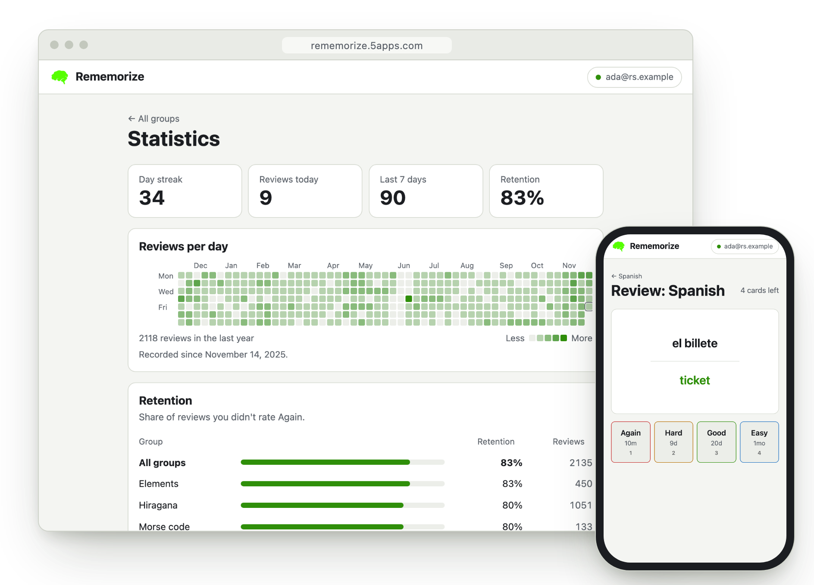

<div align="center">

<picture>
  <source media="(prefers-color-scheme: dark)" srcset="docs/assets/rememorize-dark.svg">
  <source media="(prefers-color-scheme: light)" srcset="docs/assets/rememorize-light.svg">
  
</picture>

### Flashcards that come back just before you forget them.

Spaced repetition that works offline, needs no account,<br>
and keeps your cards on storage you control.

[](https://github.com/silverbucket/rememorize/actions/workflows/ci.yml)
[](https://github.com/silverbucket/rememorize/releases)
[](LICENSE)
[](https://remotestorage.io)

**[Open Rememorize →](https://rememorize.5apps.com)**

<br>

<picture>
  <source media="(prefers-color-scheme: dark)" srcset="docs/assets/hero-dark.png">
  <source media="(prefers-color-scheme: light)" srcset="docs/assets/hero-light.png">
  
</picture>

</div>

<br>

Rememorize is a flashcard app for anything you want to keep in your head: a
language, the periodic table, the commands you look up every time. You write
the cards; it decides when to show each one, so that time goes to the cards
you are about to lose and not the ones you already know.

It runs entirely in your browser. There is nothing to sign up for, and no
server of ours that your cards pass through.

## What it does

<table>
<tr>
<td width="50%" valign="top">

**Schedules every card on its own**

Reveal the answer, then say how it went: Again, Hard, Good or Easy. Each
button shows when you would see the card next. Scheduling is
[FSRS](https://github.com/open-spaced-repetition/ts-fsrs), the open algorithm
Anki also uses, so easy cards drift out to months and hard ones stay close.

</td>
<td width="50%" valign="top">

**Works both ways**

Study a card front to back, back to front, or both. Each direction keeps its
own schedule, and only one direction of a card comes up per day, so one never
gives the other away.

</td>
</tr>
<tr>
<td width="50%" valign="top">

**Shows you it's working**

A year of reviews on a calendar, your current streak, how much you retain
overall and per group, and how many cards are coming due over the next month.

</td>
<td width="50%" valign="top">

**Keeps a steady pace**

A daily limit on new cards stops a big import from burying you. Hints help
without giving the answer away, and Undo takes back a slip of the finger.

</td>
</tr>
<tr>
<td width="50%" valign="top">

**Is yours**

Cards are saved in your browser, and the app installs to your phone or
desktop and works offline. Connect a
[remoteStorage](https://remotestorage.io) account and they sync to every
device you use, through a server you choose.

</td>
<td width="50%" valign="top">

**Lets you leave**

Import CSV, tab-separated text or Anki's “Notes in Plain Text” export. Export
a spreadsheet of your cards, or a full backup with review progress, whenever
you like.

</td>
</tr>
</table>

<br>

<div align="center">
<picture>
  <source media="(prefers-color-scheme: dark)" srcset="docs/assets/tour-dark.png">
  <source media="(prefers-color-scheme: light)" srcset="docs/assets/tour-light.png">
  
</picture>
</div>

## Getting started

1. Open **[rememorize.5apps.com](https://rememorize.5apps.com)**. To keep it
   on your home screen or dock, use your browser's _Install_ or _Add to Home
   Screen_.
2. Add a card, or import a deck you already have. Every card belongs to a
   group: a topic, a deck, a chapter.
3. Press **Review** whenever cards are due. A few minutes a day is the whole
   method.

To sync between devices, tap the status pill in the top right and enter your
remoteStorage address (`user@host`). Don't have one?
[Get a storage account](https://remotestorage.io/get/), or host your own.
Disconnecting removes the copy in that browser; your server keeps everything.

### Keyboard

| Key                                                 | Action                       |
| --------------------------------------------------- | ---------------------------- |
| <kbd>Space</kbd> or <kbd>Enter</kbd>                | Show the answer              |
| <kbd>1</kbd> <kbd>2</kbd> <kbd>3</kbd> <kbd>4</kbd> | Rate Again, Hard, Good, Easy |
| <kbd>U</kbd>                                        | Undo the last rating         |

## Your data

- **No backend.** The app is static files. Your cards go from your browser to
  your storage server and nowhere else.
- **No third-party code.** No analytics, no trackers, no fonts or scripts from
  other sites; a Content Security Policy enforces it.
- **An open format.** Cards are stored with
  [remotestorage-module-flashcards](https://github.com/silverbucket/remotestorage-module-flashcards),
  so other apps can read and write the same cards.

## Development

Rememorize is a Svelte 5 + TypeScript app built with Vite.

```sh
bun install
bun run dev    # http://localhost:5173
```

**[docs/DEVELOPMENT.md](docs/DEVELOPMENT.md)** covers the tests, the project
layout, how these screenshots are made, and how releases are cut.

## License

[GPL-3.0-or-later](LICENSE) — © 2026 Nick Jennings.

This program is free software: you can redistribute it and/or modify it
under the terms of the GNU General Public License as published by the Free
Software Foundation, either version 3 of the License, or (at your option)
any later version.

---

<div align="center">

**Built on open protocols**

<a href="https://remotestorage.io">
  <picture>
    <source media="(prefers-color-scheme: dark)" srcset="docs/assets/remotestorage-text-dark.svg">
    <source media="(prefers-color-scheme: light)" srcset="docs/assets/remotestorage-text-light.svg">
    
  </picture>
</a>

<br>

<sub><a href="https://remotestorage.io">remoteStorage</a> keeps your data yours</sub>

</div>
